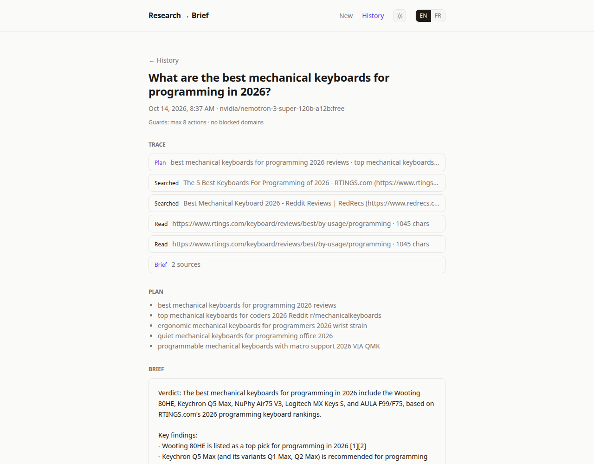
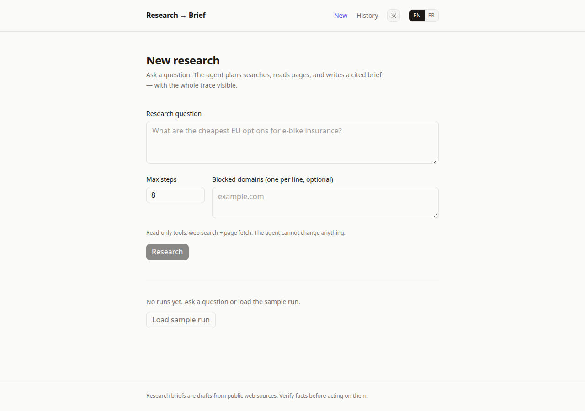
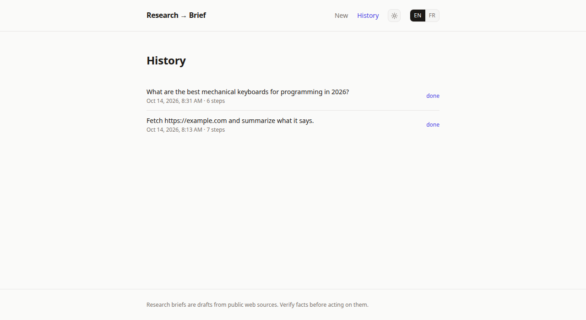

# Research → Brief

Ask a research question. An agent plans web searches, reads pages, and
writes a **cited brief**, with the whole trace visible and guardrails
enforced.



Portfolio project **#3 of 3**, the ***act*** piece. #1
(`meeting-to-actions`) shows structured extraction, #2 (`docs-to-answers`)
shows retrieval; this one shows **grounded research**: plan → search →
read → synthesize, with cost/latency transparency and safety rails.

## Demo in 2 minutes

1. `npm install && npm run dev` → http://localhost:3000
2. Click **Load sample run** (no API key needed), a real recorded trace.
3. Ask your own question: watch the plan → searches → fetches → brief
   stream in. Try blocking a domain to see the guardrail fire.




## How it works

```
question ──► plan (2–5 searches, JSON) ──► search ×3 ──► pick pages
                                                              (JSON, max 4)
                                                                  │
                    ┌─────────────────────────────────────────────┘
                    ▼
             read in parallel ──► brief (streamed, [n] validated +
             (extract API,         repair pass)
              direct fallback)
```

- **No function-calling API.** The model outputs strict JSON (a search
  plan, then URL picks), validated with zod, one repair retry each. This
  works on any free-tier chat model, including ones with weak tool
  support, and the contract is visible in `src/lib/agent.ts` instead of
  hidden in a provider SDK.
- **Read-only tools by construction**: `web_search` and `fetch_page`
  only. There is no tool that changes anything, and the UI says so.
- **Guardrails, enforced and shown**: fixed budgets (max 3 paid
  searches, up to 4 pages read — nothing to configure, nothing to burn
  through), domain blocklist (skips appear in the trace, never silent),
  cancel anytime with partial results saved.
- **Honest failures**: thin pages (under 500 chars, usually
  JavaScript-rendered portals) are flagged to the agent, which fetches
  elsewhere instead of settling; search rate limits, bot-walled pages
  and empty evidence surface as trace warnings or a clean error, never
  as invented findings.
- **Stack**: Next.js 16, React 19, Tailwind v4, `better-sqlite3`, cheerio,
  OpenAI SDK against OpenRouter. EN/FR, light/dark, 680px sober layout.

## Keys

- **Search**: Tavily if `TAVILY_API_KEY` is set (free tier, no card,
  recommended for demos), else Brave if `BRAVE_API_KEY` is set, else
  keyless DuckDuckGo HTML (works until it rate-limits the IP, the trace
  then shows honest `search-rate-limited` warnings). Page fetch is always
  keyless local extraction.
- **The agent's brain needs a key**: copy `.env.example` to `.env`, set
  `OPENAI_API_KEY` (OpenRouter, free-tier keys work; the default model is
  a free one). The sample run and history work without it.

## Deploying (Vercel)

- Set `OPENAI_API_KEY` and `TAVILY_API_KEY` in the project environment
  variables and redeploy.
- The database lives in `/tmp` there (filesystem is read-only), so
  history is ephemeral per invocation - the sample run is always
  reloadable, which is the demo path.

## Production-swap notes (deliberately not built)

- Job queue + worker for runs (today they execute inside the streaming
  request; cancel is cooperative).
- Scraping as fallback only (Tavily primary when configured).
- Auth + per-user run history (single-user sqlite today).
- Fetch cache + politeness (robots.txt, per-host pacing) before
  any serious crawl volume.

## Develop

```bash
npm install
npm run dev      # http://localhost:3000
npm run lint
npm run build
```

The sample run is a real recorded trace in `data/sample-run.json`.
